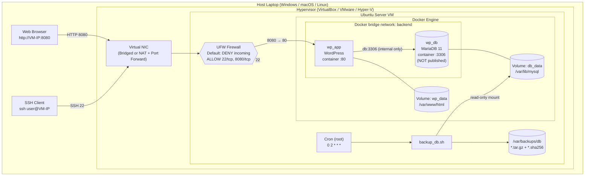

# Mission 10 – Enterprise Cloud Architect
## Operational Manual: WordPress + MariaDB on Docker (Ubuntu Server)

> **Audience:** Client IT team taking over operation of this stack.
> **Scope:** Deploy, secure, back up, restore, and maintain a two-tier containerised WordPress application running on an Ubuntu Server VM.

---

## Table of Contents

1. [Executive Summary](#1-executive-summary)
2. [Architecture & Network Topology](#2-architecture--network-topology)
3. [Repository Layout](#3-repository-layout)
4. [Requirement 1 – Base Infrastructure](#4-requirement-1--base-infrastructure)
5. [Requirement 2 – Deployment (Infrastructure as Code)](#5-requirement-2--deployment-infrastructure-as-code)
6. [Requirement 3 – Security Hardening (UFW)](#6-requirement-3--security-hardening-ufw)
7. [Requirement 4 – Automation (Backup + Cron)](#7-requirement-4--automation-backup--cron)
8. [Disaster Recovery: Restore Procedure](#8-disaster-recovery-restore-procedure)
9. [Day-2 Operations & Maintenance](#9-day-2-operations--maintenance)
10. [Troubleshooting Guide](#10-troubleshooting-guide)
11. [Security Recommendations for Production](#11-security-recommendations-for-production)
12. [Requirements Compliance Checklist](#12-requirements-compliance-checklist)
13. [Final Reflection: Mission 1 → Mission 10](#13-final-reflection-mission-1--mission-10)
14. [Appendix – Raw Code](#14-appendix--raw-code)

---

## 1. Executive Summary

| Item | Value |
|---|---|
| Application | WordPress (latest) |
| Database | MariaDB 11 |
| Orchestration | Docker Engine + Docker Compose (v2 plugin) |
| Operating System | Ubuntu Server (LTS) |
| Virtualisation | Hypervisor on host laptop (VirtualBox / VMware / Hyper-V) |
| Public entry point | `http://<VM-IP>:8080` |
| Remote admin | SSH, port `22/tcp` |
| Firewall | UFW – default **deny incoming**, allow `22/tcp` and `8080/tcp` only |
| Persistence | Named Docker volumes `db_data` (database) and `wp_data` (WordPress files) |
| Disaster recovery | `/usr/local/bin/backup_db.sh`, run daily at **02:00** by root's cron, 7-day retention |

---

## 2. Architecture & Network Topology

### 2.1 Diagram (Mermaid – renders natively on GitHub)



### 2.2 Diagram (ASCII fallback)

```
+--------------------------------------------------------------------------+
|  HOST LAPTOP                                                             |
|   [Browser] http://VM-IP:8080          [SSH client] ssh user@VM-IP       |
|        |                                        |                        |
|  +-----v----------------------------------------v--------------------+   |
|  | HYPERVISOR  (VirtualBox / VMware / Hyper-V)                       |   |
|  |   Virtual NIC (Bridged  -or-  NAT + port forwards 8080, 22)       |   |
|  |  +-------------------------------------------------------------+  |   |
|  |  | UBUNTU SERVER VM                                            |  |   |
|  |  |  +-------------------------------------------------------+  |  |   |
|  |  |  | UFW FIREWALL  default deny in | allow 22/tcp, 8080/tcp|  |  |   |
|  |  |  +--------------------------+----------------------------+  |  |   |
|  |  |                             |                               |  |   |
|  |  |  +--------------------------v----------------------------+  |  |   |
|  |  |  | DOCKER ENGINE        network: backend (bridge)        |  |  |   |
|  |  |  |   +----------------+  db:3306   +------------------+  |  |  |   |
|  |  |  |   | wp_app         |----------->| wp_db (MariaDB)  |  |  |  |   |
|  |  |  |   | WordPress :80  |            | not published    |  |  |  |   |
|  |  |  |   +-------+--------+            +---------+--------+  |  |  |   |
|  |  |  |           |                               |           |  |  |   |
|  |  |  |      [wp_data]                       [db_data]        |  |  |   |
|  |  |  +-------------------------------------------+-----------+  |  |   |
|  |  |                                              | (read-only)  |  |   |
|  |  |  cron 02:00 --> backup_db.sh --> /var/backups/db/*.tar.gz   |  |   |
|  |  +-------------------------------------------------------------+  |   |
|  +-------------------------------------------------------------------+   |
+--------------------------------------------------------------------------+
```

### 2.3 Traffic Flows

| Flow | Path | Allowed by |
|---|---|---|
| Browser → WordPress | Host → Virtual NIC → UFW `8080/tcp` → Docker `-p 8080:80` → `wp_app` | UFW rule |
| Admin → Server | Host → Virtual NIC → UFW `22/tcp` → `sshd` | UFW rule |
| WordPress → DB | `wp_app` → `db:3306` over the private `backend` network | Docker network (no host exposure) |
| Backup | Cron → script → temporary Alpine container → read-only mount of `db_data` | Local only |

> The database port **3306 is never published** to the host. Only the WordPress container can reach it.

---

## 3. Repository Layout

```
.
├── README.md                  # This Operational Manual
├── docker-compose.yml         # Infrastructure-as-Code stack definition
├── .env.example               # (Recommended) template for secrets
├── scripts/
│   ├── install_docker.sh      # Docker Engine + Compose installer
│   └── backup_db.sh           # DB volume backup with rotation
├── docs/
│   └── architecture.png       # Exported diagram (optional)
└── .gitignore                 # Must include: .env
```

---

## 4. Requirement 1 – Base Infrastructure

### 4.1 VM Specification

| Resource | Minimum | Recommended |
|---|---|---|
| vCPU | 2 | 2–4 |
| RAM | 2 GB | 4 GB |
| Disk | 20 GB | 40 GB (backups + volumes grow) |
| OS | Ubuntu Server 22.04 / 24.04 LTS | Latest LTS |
| NIC | 1 virtual adapter | Bridged |

### 4.2 Provision the VM

1. Download the **Ubuntu Server LTS ISO** from <https://ubuntu.com/download/server>.
2. In your hypervisor, create a new VM with the specification above and attach the ISO.
3. Run the installer:
   - Select **Install OpenSSH server** (needed for remote admin).
   - Create an administrative (sudo) user.
   - Accept the default LVM disk layout.
4. Reboot, remove the ISO, and log in.
5. Update the system:

```bash
sudo apt update && sudo apt full-upgrade -y
sudo reboot
```

### 4.3 VM Networking (access from the host browser)

Choose **one** of the two options.

#### Option A – Bridged Adapter (recommended)

The VM receives an IP on the same LAN as the laptop.

1. Hypervisor → VM Settings → **Network** → Adapter 1 → **Bridged Adapter** → select the laptop's active Wi-Fi/Ethernet NIC.
2. Boot the VM and find its IP:

```bash
ip -br a
```

3. From the host browser: `http://<VM-IP>:8080`
4. From the host terminal: `ssh <user>@<VM-IP>`

#### Option B – NAT with Port Forwarding

Use when bridging is blocked (e.g. campus/corporate Wi-Fi).

| Name | Protocol | Host IP | Host Port | Guest IP | Guest Port |
|---|---|---|---|---|---|
| ssh | TCP | 127.0.0.1 | 2222 | *(VM IP, e.g. 10.0.2.15)* | 22 |
| web | TCP | 127.0.0.1 | 8080 | *(VM IP)* | 8080 |

Access: `http://localhost:8080` and `ssh -p 2222 <user>@127.0.0.1`.

#### Optional – Static IP via Netplan

Edit `/etc/netplan/00-installer-config.yaml` (file name may vary):

```yaml
network:
  version: 2
  ethernets:
    enp0s3:                       # confirm name with: ip -br a
      dhcp4: false
      addresses: [192.168.1.50/24]
      routes:
        - to: default
          via: 192.168.1.1
      nameservers:
        addresses: [1.1.1.1, 8.8.8.8]
```

```bash
sudo netplan apply
```

### 4.4 Verification

```bash
ip -br a                # VM has an IP
ping -c 3 1.1.1.1       # outbound connectivity
ping -c 3 ubuntu.com    # DNS works
```

From the host: `ping <VM-IP>` must reply (bridged mode).

---

## 5. Requirement 2 – Deployment (Infrastructure as Code)

### 5.1 Install Docker Engine and Compose (official repository)

This removes any conflicting distro packages, adds Docker's official APT repository, and installs the engine, CLI, containerd, Buildx, and the Compose v2 plugin.

```bash
# 1. Remove conflicting packages (safe if none are installed)
sudo apt remove -y $(dpkg --get-selections docker.io docker-compose docker-compose-v2 docker-doc podman-docker containerd runc 2>/dev/null | cut -f1) ;

# 2. Add Docker's official GPG key and repository
sudo apt update && sudo apt install -y ca-certificates curl && \
sudo install -m 0755 -d /etc/apt/keyrings && \
sudo curl -fsSL https://download.docker.com/linux/ubuntu/gpg -o /etc/apt/keyrings/docker.asc && \
sudo chmod a+r /etc/apt/keyrings/docker.asc && \
echo "deb [arch=$(dpkg --print-architecture) signed-by=/etc/apt/keyrings/docker.asc] https://download.docker.com/linux/ubuntu $(. /etc/os-release && echo "${UBUNTU_CODENAME:-$VERSION_CODENAME}") stable" | sudo tee /etc/apt/sources.list.d/docker.list > /dev/null && \

# 3. Install Docker
sudo apt update && \
sudo apt install -y docker-ce docker-ce-cli containerd.io docker-buildx-plugin docker-compose-plugin && \

# 4. Allow the current user to run docker without sudo (re-login required)
sudo usermod -aG docker $USER && \

# 5. Smoke test
sudo docker run --rm hello-world && docker compose version
```

> **Note:** `docker compose version` without `sudo` works only after you **log out and back in** (or run `newgrp docker`) so the new group membership takes effect.

Confirm the service starts at boot:

```bash
sudo systemctl enable --now docker
systemctl is-enabled docker      # expected: enabled
```

### 5.2 The Stack Definition

The full file is in [`docker-compose.yml`](#141-docker-composeyml). Key design decisions:

| Design choice | Reason |
|---|---|
| Two services (`db`, `wordpress`) on a user-defined `backend` network | Container-to-container DNS (`db`) and isolation from other workloads |
| `db` has **no `ports:` mapping** | Database is unreachable from outside Docker |
| `healthcheck` on MariaDB + `depends_on: condition: service_healthy` | WordPress waits until the DB is actually ready, preventing first-boot connection errors |
| Named volumes `db_data`, `wp_data` | Data persists across container recreation and VM reboots |
| `restart: unless-stopped` | Containers return automatically after a reboot or crash |
| Only `8080:80` published | Smallest possible attack surface |

### 5.3 Deploy

```bash
mkdir -p ~/enterprise-stack && cd ~/enterprise-stack
# place docker-compose.yml here (git clone or copy)

docker compose config        # validate syntax
docker compose up -d         # create and start in the background
docker compose ps            # both services should be "running" / db "healthy"
```

Open `http://<VM-IP>:8080` and complete the WordPress installation wizard.

### 5.4 Persistence Test (required)

Prove the data survives a reboot:

1. Complete the WordPress setup and publish a test post titled **"Persistence Test"**.
2. Reboot the VM:

```bash
sudo reboot
```

3. After it returns, confirm containers auto-started and data is intact:

```bash
docker compose ps
docker volume ls | grep -E 'db_data|wp_data'
```

4. Reload `http://<VM-IP>:8080` – the "Persistence Test" post must still exist.

### 5.5 Volume Naming (important for the backup script)

Compose prefixes volume names with the **project name** (by default the directory name).
For a project directory named `enterprise-stack`, the volume is **`enterprise-stack_db_data`**.

Always verify the real name:

```bash
docker volume ls
docker volume inspect <name>
```

If your directory has a different name, either set `DB_VOLUME` when running the backup script or pin the project name:

```bash
export DB_VOLUME="<project>_db_data"
```

---

## 6. Requirement 3 – Security Hardening (UFW)

### 6.1 Policy

| Direction | Policy |
|---|---|
| Incoming | **DENY** (default) |
| Outgoing | ALLOW (default; needed for updates and image pulls) |

| Port | Protocol | Purpose | Allowed? |
|---|---|---|---|
| 22 | TCP | SSH remote administration | ✅ |
| 8080 | TCP | WordPress web access | ✅ |
| 3306 | TCP | MariaDB | ❌ (not exposed; internal Docker network only) |
| all others | – | – | ❌ |

### 6.2 Configure

> ⚠️ **Allow SSH *before* enabling UFW**, or you will lock yourself out of the VM.

```bash
sudo apt install -y ufw

# Default policies
sudo ufw default deny incoming
sudo ufw default allow outgoing

# Explicit allows – ONLY what is required
sudo ufw allow 22/tcp comment 'SSH admin'
sudo ufw allow 8080/tcp comment 'WordPress'

# Optional: rate-limit SSH to slow brute-force attempts (use INSTEAD of plain allow 22)
# sudo ufw limit 22/tcp comment 'SSH admin (rate limited)'

# Enable (persists across reboots)
sudo ufw enable
sudo ufw status verbose
sudo ufw status numbered
```

Expected output (abridged):

```
Status: active
Default: deny (incoming), allow (outgoing), disabled (routed)

To                         Action      From
--                         ------      ----
22/tcp                     ALLOW IN    Anywhere
8080/tcp                   ALLOW IN    Anywhere
```

### 6.3 Verify

From the **host laptop**:

```bash
# Should succeed
curl -I http://<VM-IP>:8080
ssh <user>@<VM-IP>

# Should time out / be refused
nc -zv <VM-IP> 3306
nc -zv <VM-IP> 80
```

From the **VM**:

```bash
sudo ss -tulpn          # list listening sockets
sudo ufw status verbose
```

### 6.4 ⚠️ Known Caveat: Docker and UFW

Docker manipulates `iptables` directly. **Ports published with `-p` / `ports:` can bypass UFW rules.** In this stack that is acceptable because:

- the only published port (`8080`) is one we *intentionally* allow, and
- the database has **no published port**.

**Rule for the client team:** never add a `ports:` mapping to the `db` service. If more services are published in future, restrict them with the `DOCKER-USER` iptables chain or bind them to localhost (e.g. `"127.0.0.1:3306:3306"`).

### 6.5 Additional Host Hardening (recommended)

```bash
# Automatic security updates
sudo apt install -y unattended-upgrades
sudo dpkg-reconfigure -plow unattended-upgrades

# Fail2ban for SSH brute-force protection
sudo apt install -y fail2ban
sudo systemctl enable --now fail2ban
```

SSH key-only login (after copying your public key with `ssh-copy-id`), in `/etc/ssh/sshd_config`:

```
PermitRootLogin no
PasswordAuthentication no
```

```bash
sudo sshd -t && sudo systemctl restart ssh
```

---

## 7. Requirement 4 – Automation (Backup + Cron)

### 7.1 What the Script Does

`/usr/local/bin/backup_db.sh` performs a disaster-recovery backup of the database volume:

| Step | Action |
|---|---|
| 0 | Takes a lock (`flock`) so two backups cannot overlap |
| 1 | Verifies the Docker volume exists, then archives it with a throw-away Alpine container, mounting the volume **read-only** |
| 2 | Verifies the archive (`tar tzf`) and writes a **SHA-256 checksum** file |
| 3 | **Rotates** backups and checksums older than `RETENTION_DAYS` (default 7) |
| – | Logs every step to `/var/log/db_backup.log`; on error it deletes the partial archive and exits non-zero (`set -euo pipefail`) |

Configurable via environment variables:

| Variable | Default |
|---|---|
| `DB_VOLUME` | `enterprise-stack_db_data` |
| `BACKUP_DIR` | `/var/backups/db` |
| `LOG_FILE` | `/var/log/db_backup.log` |
| `RETENTION_DAYS` | `7` |

Full source: [Appendix 14.2](#142-backup_dbsh).

### 7.2 Install

```bash
sudo tee /usr/local/bin/backup_db.sh > /dev/null << 'EOF'
# ... paste script from Appendix 14.2 ...
EOF

sudo chmod +x /usr/local/bin/backup_db.sh      # make executable
ls -l /usr/local/bin/backup_db.sh              # expect -rwxr-xr-x
```

### 7.3 Schedule with Cron (daily at 02:00)

This idempotent one-liner removes any previous entry for the script before adding the new one (no duplicates):

```bash
( sudo crontab -l 2>/dev/null | grep -vF "/usr/local/bin/backup_db.sh" || true
  echo "0 2 * * * /usr/local/bin/backup_db.sh >> /var/log/db_backup_cron.log 2>&1" ) | sudo crontab -
```

Cron expression breakdown:

```
0   2   *   *   *   command
│   │   │   │   └─ day of week (any)
│   │   │   └───── month (any)
│   │   └───────── day of month (any)
│   └───────────── hour (02)
└───────────────── minute (00)
```

Verify:

```bash
sudo crontab -l
systemctl status cron
```

### 7.4 Test and Verify

```bash
sudo /usr/local/bin/backup_db.sh
ls -lh /var/backups/db/
tail -n 5 /var/log/db_backup.log
```

Expected log:

```
[2026-11-13 02:00:01] === Backup started ===
[2026-11-13 02:00:03] Backup OK: /var/backups/db/db_backup_2026-11-13_02-00-01.tar.gz (4.2M)
[2026-11-13 02:00:03] Rotation: removed 0 file(s) older than 7 days
[2026-11-13 02:00:03] === Backup finished successfully ===
```

Verify a backup's integrity at any time:

```bash
cd /var/backups/db
sha256sum -c db_backup_<timestamp>.tar.gz.sha256
```

### 7.5 Backup Limitations & Improvement

The script archives the live data directory. This is **crash-consistent** (InnoDB can normally recover), but a logical dump is safer for guaranteed consistency. For production, add a SQL dump alongside the volume archive:

```bash
docker exec wp_db sh -c 'mariadb-dump -u root -p"$MARIADB_ROOT_PASSWORD" --single-transaction --all-databases' \
  | gzip > /var/backups/db/sql_dump_$(date +%F_%H-%M-%S).sql.gz
```

Also copy backups **off the VM** (second disk, NAS, or object storage); a backup on the same disk does not survive disk failure.

### 7.6 Log Rotation for the Script's Own Logs

Create `/etc/logrotate.d/db_backup`:

```
/var/log/db_backup.log /var/log/db_backup_cron.log {
    weekly
    rotate 4
    compress
    missingok
    notifempty
}
```

---

## 8. Disaster Recovery: Restore Procedure

**Scenario:** the database volume is lost or corrupted.

```bash
cd ~/enterprise-stack

# 1. Pick the backup and verify its checksum
ls -lh /var/backups/db/
cd /var/backups/db && sha256sum -c db_backup_<TIMESTAMP>.tar.gz.sha256 && cd -

# 2. Stop the stack (keeps volumes)
docker compose down

# 3. Remove the damaged volume (name from `docker volume ls`)
docker volume rm enterprise-stack_db_data

# 4. Recreate it and restore the archive into it
docker volume create enterprise-stack_db_data
docker run --rm \
  -v enterprise-stack_db_data:/target \
  -v /var/backups/db:/backup:ro \
  alpine sh -c "cd /target && tar xzf /backup/db_backup_<TIMESTAMP>.tar.gz"

# 5. Start the stack and verify
docker compose up -d
docker compose ps
docker compose logs --tail=50 db
```

Open `http://<VM-IP>:8080` and confirm content is restored.

> **Practice this procedure** at least once per quarter. An untested backup is not a backup.

**Full-VM loss:** reinstall Ubuntu → install Docker (§5.1) → restore `docker-compose.yml` from Git → restore the DB volume (above) → re-apply UFW (§6) → reinstall the backup script and cron job (§7).

---

## 9. Day-2 Operations & Maintenance

### 9.1 Daily Commands

| Task | Command |
|---|---|
| Status | `docker compose ps` |
| Logs (follow) | `docker compose logs -f` |
| Logs (one service) | `docker compose logs --tail=100 wordpress` |
| Restart a service | `docker compose restart wordpress` |
| Stop (keep data) | `docker compose down` |
| Start | `docker compose up -d` |
| Resource usage | `docker stats --no-stream` |
| Disk usage | `df -h && docker system df` |
| Shell into DB | `docker exec -it wp_db mariadb -u root -p` |

> ⚠️ **Never run `docker compose down -v`** – the `-v` flag **deletes the volumes and all data**.

### 9.2 Updating the Stack

Take a backup first, then:

```bash
sudo /usr/local/bin/backup_db.sh
cd ~/enterprise-stack
docker compose pull
docker compose up -d
docker image prune -f
```

For production, **pin image versions** (e.g. `wordpress:6.7-apache`) instead of `latest` so upgrades are deliberate and reversible.

### 9.3 Host Patching

```bash
sudo apt update && sudo apt upgrade -y
[ -f /var/run/reboot-required ] && echo "Reboot needed"
```

### 9.4 Maintenance Schedule

| Frequency | Task |
|---|---|
| Daily (automatic) | Backup at 02:00 |
| Weekly | Check `/var/log/db_backup.log`, `docker compose ps`, `df -h` |
| Monthly | `apt upgrade`, `docker compose pull`, review `ufw status`, review SSH logs (`journalctl -u ssh`) |
| Quarterly | **Test restore**, rotate passwords, review user accounts |

### 9.5 Health Check One-Liner

```bash
docker compose ps && sudo ufw status | head -n 1 && tail -n 3 /var/log/db_backup.log && df -h / | tail -n 1
```

---

## 10. Troubleshooting Guide

| Symptom | Likely cause | Resolution |
|---|---|---|
| Browser cannot reach `:8080` | UFW blocking, wrong IP, NAT without port forward | `sudo ufw status`; `ip -br a`; check hypervisor networking |
| "Error establishing a database connection" | DB not healthy yet or wrong credentials | `docker compose logs db`; ensure `WORDPRESS_DB_*` match `MARIADB_*` |
| `permission denied` on docker socket | User not yet in `docker` group | Log out/in, or `newgrp docker` |
| `docker: command not found` | Install incomplete | Re-run §5.1 |
| Backup fails: *Docker volume not found* | `DB_VOLUME` default doesn't match actual name | `docker volume ls`; set `DB_VOLUME=<correct name>` |
| Backup: *Another backup is already running* | Lock held by a running/stuck job | `ps aux \| grep backup_db`; wait, or remove `/tmp/backup_db.lock` if no process exists |
| Cron job doesn't run | Entry missing or cron stopped | `sudo crontab -l`; `systemctl status cron`; read `/var/log/db_backup_cron.log` |
| Disk filling up | Old images/backups | `docker system df`; `docker image prune -a`; check `RETENTION_DAYS` |
| Locked out after enabling UFW | SSH not allowed first | Use hypervisor console → `sudo ufw allow 22/tcp` |
| DB container restarting | Corrupt volume or bad env change | `docker compose logs db`; restore from backup (§8) |

---

## 11. Security Recommendations for Production

This lab stack uses **simplified credentials for demonstration**. Before real-world use:

1. **Remove hard-coded passwords** from `docker-compose.yml`. Use an `.env` file (git-ignored) or Docker secrets:

   ```yaml
   environment:
     MARIADB_ROOT_PASSWORD: ${DB_ROOT_PASSWORD}
     MARIADB_PASSWORD: ${DB_PASSWORD}
   ```

   `.env.example` (commit this; never commit `.env`):

   ```
   DB_ROOT_PASSWORD=change_me_long_random
   DB_PASSWORD=change_me_long_random
   ```

   Generate strong values: `openssl rand -base64 24`

2. **Add HTTPS.** Put a reverse proxy (Nginx Proxy Manager, Traefik, or Caddy) in front of WordPress with a TLS certificate, then allow `443/tcp` and remove public `8080`.
3. **Pin image versions** rather than `latest`.
4. **Key-only SSH**, `fail2ban`, and `unattended-upgrades` (§6.5).
5. **Off-site backups** and encrypted backup storage.
6. **Restrict the backup directory:** `sudo chmod 700 /var/backups/db`.
7. Add **resource limits** (`mem_limit`, `cpus`) to containers to prevent a runaway service from starving the host.

---

## 12. Requirements Compliance Checklist

| # | Requirement | Evidence | Status |
|---|---|---|---|
| 1a | Architecture / topology diagram | §2 (Mermaid + ASCII) | ☐ |
| 1b | VM provisioned with Ubuntu Server | §4.2 – screenshot `ubuntu-version` | ☐ |
| 1c | VM reachable from host browser | §4.3 – screenshot of WordPress in host browser | ☐ |
| 2a | Docker + Compose installed | §5.1 – `docker compose version` output | ☐ |
| 2b | Complete `docker-compose.yml` | §14.1 | ☐ |
| 2c | ≥ 2 linked containers | WordPress + MariaDB on `backend` network | ☐ |
| 2d | Persistent volumes survive reboot | §5.4 – post survives `sudo reboot` | ☐ |
| 3a | UFW enabled | §6.2 – `ufw status verbose` | ☐ |
| 3b | Default deny incoming | §6.2 | ☐ |
| 3c | Only 22/tcp and 8080/tcp allowed | §6.2 | ☐ |
| 4a | Custom Bash script | §14.2 | ☐ |
| 4b | Script is executable | `ls -l` shows `-rwxr-xr-x` | ☐ |
| 4c | Cron job scheduled | `sudo crontab -l` shows `0 2 * * *` | ☐ |
| 5a | Operational Manual in repo | This document | ☐ |
| 5b | Raw code in repo | §14 + repo files | ☐ |
| 5c | Final reflection | §13 | ☐ |

Tick each box once you have captured the matching screenshot or terminal output for your submission.

---

## 13. Final Reflection: Mission 1 → Mission 10

> *Personalise the bracketed items with the specific topics of your own Missions 1–9.*

Mission 10 is where the individual skills from the previous missions stopped being separate exercises and became one system. At the beginning of the course, my work was about **getting a single thing to run**: a command that worked, a service that started, a file that saved. By the end, the question had changed to **"will this keep running, safely, without me watching it?"**

**From commands to systems.** Early missions [e.g., Linux navigation, file permissions, package management] taught me the vocabulary of the command line. In Mission 10 that vocabulary became a pipeline: one chained command removes conflicting packages, adds a signed repository, installs Docker, and verifies the result with a smoke test. Learning to write commands that are *idempotent and verifiable* rather than just "typed once and hoped for" was a real shift in mindset.

**From one machine to layers.** The architecture diagram forced me to see the whole stack at once: host laptop, hypervisor, virtual NIC, Ubuntu VM, firewall, Docker engine, containers, volumes. Earlier missions on [e.g., virtualisation, networking, IP addressing, services] each described one layer. Debugging "why can't my browser reach the site?" meant walking down the layers in order: hypervisor networking, VM IP, UFW, Docker port mapping, container health. Troubleshooting became a method, not guesswork.

**From default-open to default-deny.** Security earlier in the course was a topic; here it was a design constraint. Setting UFW to *default deny* and then opening only `22` and `8080` made me define precisely what the application needs. Keeping MariaDB off the published ports, and learning that Docker can bypass UFW for published ports, taught me that a firewall is one layer rather than a guarantee, and that trusting a tool without understanding its behaviour is a risk.

**From manual to autonomous.** Missions involving [e.g., shell scripting, users and permissions, scheduling] converged in the backup script: strict mode (`set -euo pipefail`), locking to prevent overlap, read-only mounts, integrity verification, checksums, retention, and logging. Adding cron turned a task I would have to remember into a task the server does by itself. The most important lesson here was that **a backup is only real once the restore has been tested**, which is why the restore runbook is part of this manual.

**From "it works" to "someone else can run it."** Infrastructure as Code and documentation reframed my goal. A `docker-compose.yml` in Git is a reproducible, reviewable definition of the environment; this manual is the handover that lets a client's IT team operate it without me. Writing for a different reader exposed gaps I had skipped over, such as the volume-naming dependency between Compose and the backup script, and the fact that hard-coded demo passwords are acceptable in a lab but not in production.

**What I would do next.** Add HTTPS through a reverse proxy, move secrets to `.env`/Docker secrets, pin image versions, ship backups off-site, and add monitoring and alerting (for example, a health-check script that notifies on failure). Those items are listed in §11 because identifying the remaining risk is part of being an architect.

**Closing thought.** Ten missions took me from running commands to designing, securing, automating, and documenting a service. The technologies (Linux, networking, virtualisation, Docker, firewalls, scripting, cron) are individually simple; the skill is in how they fit together and in being able to explain the design to someone else.

---

## 14. Appendix – Raw Code

### 14.1 `docker-compose.yml`

```yaml
# Mission 10 - Enterprise Cloud Architect
# Stack: WordPress (web) + MariaDB (database)
# Deploy: docker compose up -d

services:
  db:
    image: mariadb:11
    container_name: wp_db
    restart: unless-stopped
    environment:
      MARIADB_ROOT_PASSWORD: RootPass123
      MARIADB_DATABASE: wordpress
      MARIADB_USER: wpuser
      MARIADB_PASSWORD: WpPass123
    volumes:
      - db_data:/var/lib/mysql
    networks:
      - backend
    healthcheck:
      test: ["CMD", "healthcheck.sh", "--connect", "--innodb_initialized"]
      interval: 10s
      timeout: 5s
      retries: 5
      start_period: 30s

  wordpress:
    image: wordpress:latest
    container_name: wp_app
    restart: unless-stopped
    depends_on:
      db:
        condition: service_healthy
    ports:
      - "8080:80"
    environment:
      WORDPRESS_DB_HOST: db:3306
      WORDPRESS_DB_NAME: wordpress
      WORDPRESS_DB_USER: wpuser
      WORDPRESS_DB_PASSWORD: WpPass123
    volumes:
      - wp_data:/var/www/html
    networks:
      - backend

volumes:
  db_data:
  wp_data:

networks:
  backend:
    driver: bridge
```

### 14.2 `backup_db.sh`

```bash
#!/usr/bin/env bash
# backup_db.sh - Automated DB volume backup with rotation (Disaster Recovery)
set -euo pipefail

DB_VOLUME="${DB_VOLUME:-enterprise-stack_db_data}"
BACKUP_DIR="${BACKUP_DIR:-/var/backups/db}"
LOG_FILE="${LOG_FILE:-/var/log/db_backup.log}"
RETENTION_DAYS="${RETENTION_DAYS:-7}"
LOCK_FILE="/tmp/backup_db.lock"

TIMESTAMP="$(date +%Y-%m-%d_%H-%M-%S)"
BACKUP_FILE="${BACKUP_DIR}/db_backup_${TIMESTAMP}.tar.gz"

log()  { echo "[$(date '+%Y-%m-%d %H:%M:%S')] $*" | tee -a "$LOG_FILE"; }
fail() { log "ERROR: $*"; rm -f "$BACKUP_FILE"; exit 1; }

# Prevent overlapping runs
exec 200>"$LOCK_FILE"
flock -n 200 || { echo "Another backup is already running."; exit 1; }

mkdir -p "$BACKUP_DIR"
touch "$LOG_FILE"
log "=== Backup started ==="

# 1. Create backup (volume mounted read-only)
docker volume inspect "$DB_VOLUME" >/dev/null 2>&1 || fail "Docker volume '$DB_VOLUME' not found"
docker run --rm -v "${DB_VOLUME}":/source:ro -v "${BACKUP_DIR}":/backup \
    alpine tar czf "/backup/$(basename "$BACKUP_FILE")" -C /source . \
    || fail "Backup failed"

# 2. Verify integrity + checksum
tar tzf "$BACKUP_FILE" >/dev/null 2>&1 || fail "Archive failed integrity check"
( cd "$BACKUP_DIR" && sha256sum "$(basename "$BACKUP_FILE")" > "$(basename "$BACKUP_FILE").sha256" )
log "Backup OK: $BACKUP_FILE ($(du -h "$BACKUP_FILE" | cut -f1))"

# 3. Rotate old backups
DELETED="$(find "$BACKUP_DIR" -name 'db_backup_*' -type f -mtime +"$RETENTION_DAYS" -print -delete | wc -l)"
log "Rotation: removed ${DELETED} file(s) older than ${RETENTION_DAYS} days"
log "=== Backup finished successfully ==="
```

### 14.3 Cron Entry

```cron
0 2 * * * /usr/local/bin/backup_db.sh >> /var/log/db_backup_cron.log 2>&1
```

### 14.4 UFW Commands

```bash
sudo ufw default deny incoming
sudo ufw default allow outgoing
sudo ufw allow 22/tcp comment 'SSH admin'
sudo ufw allow 8080/tcp comment 'WordPress'
sudo ufw enable
sudo ufw status verbose
```

---

*End of Operational Manual.*
